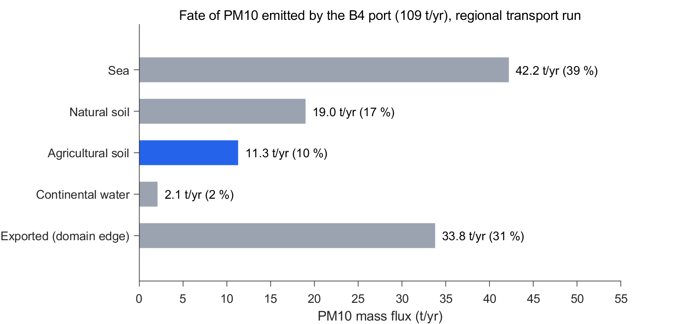
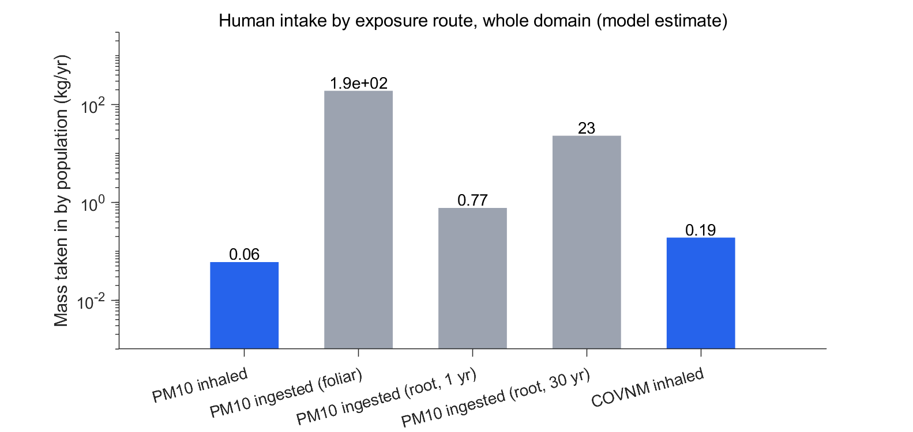

# WEEX DEPOL S7 2026-27 — Groupe B4 (Effergie)

Dépôt de travail du groupe B4 : données, code Matlab, résultats et livrables.

| | |
|---|---|
| Commanditaire | Effergie — N+1 : Céline Besançon |
| Site d'émission (phase 1) | `id_grid = 32_27`, Bantania, *Industrial and commercial port* (partagé avec B2, B6) |
| Polluants (phase 1) | PM10 : 1,09·10⁵ kg/an ; COVNM : 3,28·10⁵ kg/an |
| Phase 1 | lundi 8:00 → mercredi 8:30 |
| Phase 2 | mercredi → vendredi (débat scientifique éventuel vendredi après-midi) |

> Les documents d'analyse sont rédigés en **chinois** (équations et phrases pour l'oral en **français**). Les noms de fichiers, variables, figures et tableaux sont en anglais. / 分析文档为中文（口试用的法语句子与公式已给出），文件名、变量、图表用英文。

## Résultats clés (phase 1) / 第一阶段核心结果

**Le port B4 (PM10 109 t/an, COVNM 328 t/an) cause ≈ 2,4 DALY/an, dont 88 % dus aux PM10 ; pour les PM10, la moitié par inhalation, la moitié par ingestion via les cultures (dépôt sur les feuilles).**

| Grandeur | PM10 | COVNM | Source (fichier) | Statut |
|---|---|---|---|---|
| Concentration maille source (modèle boîte) | 0,0077 µg/m³ | 0,024 µg/m³ | `results/tables/b4_schema_summary_matlab.csv` | exécuté sous MATLAB R2024b |
| Durée de vie atmosphérique | 1,42 j | 2,89 j | idem | exécuté sous MATLAB |
| Part du dépôt humide | 93 % | — (gaz, pas de dépôt) | idem | exécuté sous MATLAB |
| Dépôt maille source | 9,7 t/an | — | idem | exécuté sous MATLAB |
| Ingestion via cultures (domaine, an 1) | 191 kg/an | — | idem | exécuté sous MATLAB (paramètres cultures = **hypothèses**) |
| Inhalation (domaine) | 0,060 kg/an | 0,19 kg/an | valeurs `REG` issues du run de transport | run de transport **Python**, non relancé sous MATLAB |
| Dommage (domaine) | 2,10 DALY/an | 0,28 DALY/an | idem | **prédiction théorique** : dépend de l'usage des CF USEtox (interprétation A) |
| Contrôle épidémiologique (inhalation PM10) | 3,5 (0,9–11) DALY/an | — | `b4_schema_summary_matlab.csv` (`epi_D_*`) | exécuté sous MATLAB ; soutient l'interprétation A (USEtox-A = 1,05) |
| Ozone, borne sup. maille source | — | ≤ 0,0035 µg/m³ | idem | borne théorique (MIR ≈ 3 de mémoire, à vérifier) |

| Fig. | Contenu |
|---|---|
|  | Devenir des PM10 émis par B4 sur un an (domaine régional) : mer 39 %, sols naturels 17 %, sols agricoles 10 %, eaux continentales 2 %, sortie du domaine 31 %. Généré par MATLAB à partir des valeurs du run de transport. |
|  | Masse absorbée par la population par voie d'exposition (échelle log). L'ingestion (feuilles) dépasse l'inhalation d'un facteur ≈ 3200 en masse, mais les dommages sont comparables. |

## Index des fichiers / 文件索引

### Code

| Fichier | Contenu | Comment l'utiliser | Statut |
|---|---|---|---|
| [`src/matlab/b4_schema_model.m`](src/matlab/b4_schema_model.m) | **v04, version courante.** Modèle complet suivant le schéma-bloc : boîte atmosphérique maille source → dépôt sec/humide → sols/eaux → cultures (feuilles + racines) → ingestion ; inhalation ; USEtox → DALY ; dégradation COVNM par OH et borne ozone ; contrôle épidémiologique (§7b) ; sensibilité ; 23 auto-tests | MATLAB R2019b+, `Run`. Aucun toolbox, **n'a pas besoin de `map.xlsx`** (valeurs de la maille 32_27 écrites en §1, résultats régionaux dans la structure `REG`). Sorties dans `src/matlab/results/` (ignoré par Git ; les copies de référence sont dans `results/`) | Exécuté sous MATLAB R2024b le 17/11, CSV et figures générés ; 23 tests attendus (12 comparaisons au Python + 11 contrôles physiques) |
| [`src/matlab/archive/b4_schema_model_v02.m`](src/matlab/archive/b4_schema_model_v02.m) | Version v02 (sans contrôle épidémiologique), 19 auto-tests | Conservée pour traçabilité ; correspond au log `results/logs/..._v02.txt` | Exécuté sous MATLAB R2024b, 19/19 PASS |
| `L1_2_B4_IA.m` | Transport régional 2D (volumes finis, schéma amont, vent annuel), livrable L1_2 | — | **Absent du dépôt** (pas trouvé sur l'ordinateur partagé) → à ajouter dans `deliverables/L1_2_matlab/` |
| `B4_deposition_surface.m` | Post-traitement C₂₀₀ → dépôt au sol par maille | — | **Absent du dépôt** ; jamais exécuté sous MATLAB (contrôle statique seulement) |

### Résultats

| Fichier | Contenu | Produit par | Statut |
|---|---|---|---|
| [`results/tables/b4_schema_summary_matlab.csv`](results/tables/b4_schema_summary_matlab.csv) | 59 grandeurs `quantity,value` (taux de dépôt, concentrations, dépôts, ingestion, inhalation, DALY par voie, contrôle épidémiologique, COVNM dégradé, ozone). Unités dans le nom (`_s-1`, `_ug_m3`, `_kg`, `_t`, `_d`) ; `D_*` en DALY/an | `b4_schema_model.m` v04 | MATLAB |
| [`results/tables/b4_schema_sensitivity_ingestion_matlab.csv`](results/tables/b4_schema_sensitivity_ingestion_matlab.csv) | Sensibilité de l'ingestion PM10 (domaine) : `f_int`, `t_w`, `BCF`, accumulation 30 ans → ×0,34 à ×1,90 | idem | MATLAB |
| [`results/figures/b4_pm10_fate_region_matlab.png`](results/figures/b4_pm10_fate_region_matlab.png) / [`.svg`](results/figures/b4_pm10_fate_region_matlab.svg) | Devenir régional des PM10 (barres, t/an) | idem | MATLAB |
| [`results/figures/b4_intake_by_route_matlab.png`](results/figures/b4_intake_by_route_matlab.png) / [`.svg`](results/figures/b4_intake_by_route_matlab.svg) | Masse absorbée par voie (log, kg/an) | idem | MATLAB |
| [`results/figures/preview/`](results/figures/preview/) | Mêmes deux figures, rendu de prévisualisation utilisé dans les documents (mêmes valeurs, **pas** la sortie MATLAB) | rendu hors MATLAB | aperçu |
| [`results/logs/b4_schema_matlab_run_20261117_v02.txt`](results/logs/b4_schema_matlab_run_20261117_v02.txt) | Sortie console complète du run MATLAB R2024b du 17/11 15:25 (`evalc`) | v02 | MATLAB, 19/19 PASS. Pas de log capturé pour v04 |

### Documents

| Fichier | Contenu (中文说明) | Langue |
|---|---|---|
| [`docs/cadrage/WEEX_DEPOL_phase1_cadrage_zh_B4.md`](docs/cadrage/WEEX_DEPOL_phase1_cadrage_zh_B4.md) | Traduction intégrale du cadrage phase 1 + données B4 extraites de `map.xlsx` et USEtox, squelette de schéma-bloc, répartition des rôles / phase 1 任务书全译 + B4 场址数据与分工 | zh |
| [`docs/cadrage/WEEX_DEPOL_moodle_overview_zh.md`](docs/cadrage/WEEX_DEPOL_moodle_overview_zh.md) | Synthèse de tout Moodle : calendrier de la semaine, livrables, évaluation, jetons, audit CodeCert, liste des ressources, incohérences à vérifier / Moodle 全部内容、时间线、交付物、评价、代币、审计、资源清单、待确认问题 | zh |
| [`docs/notes/B4_schema_bloc_modele_complet_zh.md`](docs/notes/B4_schema_bloc_modele_complet_zh.md) | **Document de référence du modèle** : correspondance schéma → équations, taux d'élimination, modèle boîte, dépôt, chaîne sol–culture, inhalation, DALY, contrôle épidémiologique, chimie (OH, ozone), toutes les hypothèses, sensibilité, propositions de modification du schéma / 方框图完整建模（主文档） | zh |
| [`docs/notes/B4_deposition_surface_calc_zh.md`](docs/notes/B4_deposition_surface_calc_zh.md) | De C à 200 m au dépôt au sol : v_d (modèle de résistances), C au sol, lessivage intermittent (USEtox éq. 91), répartition par usage des sols / 200 m 浓度 → 地表沉降的完整推导 | zh |
| [`docs/notes/parametres.md`](docs/notes/parametres.md) | Tableau des paramètres (valeur, unité, source, statut) | fr |
| [`deliverables/L1_3_oral/B4_L1_3_reponses_a_e_zh_fr.md`](deliverables/L1_3_oral/B4_L1_3_reponses_a_e_zh_fr.md) | **Version finale pour l'oral** : réponses complètes aux questions a–e du jury + réponses rapides en français / 口试 a–e 完整回答（最新版） | zh + fr |
| [`deliverables/L1_3_oral/B4_phase1_oral_prep_zh_fr.md`](deliverables/L1_3_oral/B4_phase1_oral_prep_zh_fr.md) | Première préparation de l'oral (16/11) + mode d'emploi de `L1_2_B4_IA.m` ; certains chiffres remplacés par le document précédent / 第一版口试准备 + L1_2 代码说明（部分数值已被上一份文档更新） | zh + fr |

**Ordre de lecture conseillé / 建议阅读顺序** : `B4_L1_3_reponses_a_e_zh_fr.md` → `B4_schema_bloc_modele_complet_zh.md` → `B4_deposition_surface_calc_zh.md` → cadrage.

### Manquant dans le dépôt / 仓库中尚缺

- `data/raw/` : `map.xlsx`, `MODELISATION_infos_polluants_S6_2025-26.xlsx` (fichiers Moodle). **Dépôt public** → à n'ajouter que si le dépôt devient privé.
- `deliverables/L1_1_schema_bloc/` : le `.pptx` remis lundi.
- `deliverables/L1_2_matlab/` : `L1_2_B4_IA.m` remis mercredi.
- `B4_deposition_surface.m`, image `b4_phase1_maps_python_reference.png` citée dans `B4_phase1_oral_prep_zh_fr.md`.

## Arborescence

```
WEEX26/
├── data/
│   ├── raw/            # fichiers Moodle d'origine (map.xlsx, infos_polluants...) — NE JAMAIS MODIFIER
│   └── processed/      # données extraites / nettoyées (CSV, MAT)
├── src/
│   ├── matlab/         # code de développement (peut être modulaire)
│   └── python/         # scripts de vérification croisée
├── deliverables/       # versions REMISES sur Moodle, figées
│   ├── L1_0_contact/
│   ├── L1_1_schema_bloc/   # L1_1_B4(_IA).pptx — lundi 17:00
│   ├── L1_2_matlab/        # L1_2_B4(_IA).m   — mercredi 8:30
│   ├── L1_3_oral/          # préparation oral mercredi
│   └── phase2/             # livrables vendredi (Matlab + slides + Excel)
├── results/
│   ├── figures/        # PNG + SVG/PDF
│   ├── tables/         # CSV
│   ├── mat/
│   └── logs/
├── docs/
│   ├── cadrage/        # énoncé, traductions, synthèses
│   ├── notes/          # notes par thème (transport, dépôt, USEtox, chimie...)
│   └── meetings/       # comptes rendus (consultants, réunions d'équipe)
├── references/         # articles, docs USEtox, sources des paramètres
└── ai_usage/           # journal d'utilisation de l'IA (prompts + réponses + modifications)
```

## Règles d'équipe

1. **`data/raw/` est en lecture seule.** On ne modifie jamais un fichier Moodle ; on écrit dans `data/processed/`.
2. **Livrable remis = fichier figé.** Une fois déposé sur Moodle, on le copie dans `deliverables/...` et on crée un tag Git (`L1_1`, `L1_2`, ...). On ne le modifie plus ; une nouvelle version porte `_v02`.
3. **Contrainte Matlab du livrable** : un seul fichier `.m`, qui tourne avec `Run` sur l'ordinateur de l'enseignant, à partir de `map.xlsx` uniquement (fichier vent non fourni → prévoir un repli).
4. **IA** : tout usage (même partiel) → suffixe `_IA` dans le nom du livrable + entrée dans `ai_usage/AI_LOG.md` (outil, prompt, réponse brute, ce qu'on a modifié).
5. **Paramètres** : chaque valeur numérique (H, v_d, K, t_1/2, CF...) a une unité et une source, notée dans `docs/notes/parametres.md`. Une hypothèse sans source est marquée **HYPOTHÈSE**.
6. **Statut des résultats** : distinguer *exécuté sous Matlab* / *vérifié en Python* / *contrôle statique* / *estimation à la main*.
7. **Noms de fichiers** : minuscules, `_`, contenu + méthode + cas, ex. `pm10_concentration_annual_wind_v01.png`.
8. **Fichiers vent** (`Vent1AnFinal.mat`, `Vent1MoisFinal.mat`) : à placer dans `data/raw/` en local, **exclus de Git** (volumineux, disponibles sur Moodle).

## Démarrage rapide

Guide détaillé (avec ou sans Git) : **[CONTRIBUTING.md](CONTRIBUTING.md)**.

```bash
git clone https://github.com/AlanYongzx/WEEX26.git
cd WEEX26
# copier depuis Moodle dans data/raw/ : map.xlsx, MODELISATION_infos_polluants_*.xlsx, Vent1AnFinal.mat
```

Matlab : ouvrir `deliverables/L1_2_matlab/`, y copier `map.xlsx` (et éventuellement le fichier vent), puis `Run`.

## Échéances

| Échéance | Livrable | Statut |
|---|---|---|
| lun. 9:30 | L1_0 — contact | ☐ |
| lun. 17:00 | L1_1 — schéma bloc v1 (.pptx/.odp, blocs éditables) | ☐ |
| mer. 8:30 | L1_2 — Matlab mono-fichier | ☐ |
| mer. 9:00–12:15 | L1_3 — oral au tableau (~17 min) | ☐ |
| ven. | Phase 2 — Matlab + slides + Excel | ☐ |

## Répartition des rôles

| Rôle | Membre | Dossiers principaux |
|---|---|---|
| Données & terme source | | `data/`, `src/matlab/` |
| Transport atmosphérique | | `docs/notes/transport.md` |
| Dépôt & dégradation | | `docs/notes/depot.md` |
| Toxicologie / USEtox, impact santé, partie chimie | | `docs/notes/usetox.md`, `docs/notes/chimie.md` |
| Méthodes numériques & code | | `src/matlab/` |
| Intégration & oral | | `deliverables/L1_3_oral/` |
