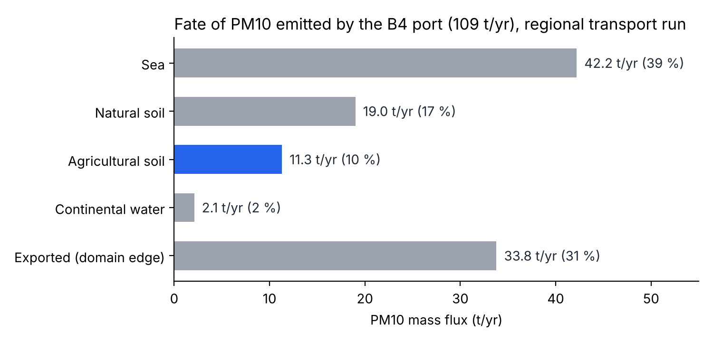
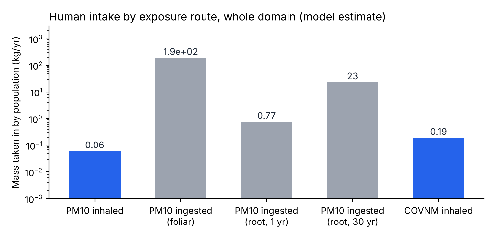

# B4 方框图完整建模：从港口排放到人体健康损害

> 依据：本组定稿的 schéma-bloc（对流层 → 干/湿沉降 → 陆地水体与海洋 / 农业用地 53% → 土壤传递 → 植物富集 → 摄入；悬浮颗粒 → 吸入）。
> 只用方框图里已有的介质和箭头，不新增介质。
> 配套代码 `b4_schema_model.m`（单文件 MATLAB，**已在 MATLAB R2024b 中运行，v04 23/23 自检通过**），结果写到脚本所在文件夹的 `results/`。

---

## 0. 结论与验证状态

**B4 港口（PM10 109 t/yr，COVNM 328 t/yr）造成的健康损害约 2.4 DALY/yr，PM10 占 88%。PM10 的损害一半来自吸入、一半来自经作物摄入；但摄入途径里起主导作用的是"颗粒直接落在作物叶面"，不是方框图画的"土壤 → 植物"，后者小 250 倍（第 1 年）到 8 倍（30 年累积）。臭氧不纳入模型：B4 没有 NOx 数据，且即使按上限估算，源网格的臭氧增量也只有约 0.003 µg/m³。**

| 内容 | 状态 |
|---|---|
| 源网格大气箱模型、沉降、土壤—作物链、吸入、COVNM 降解、臭氧上限、敏感性 | **已在 MATLAB R2024b 中运行**（`b4_schema_model.m`），23 项自检全部通过（v04）：12 项与独立 Python 实现的数值比对（相对误差 ≤ 2×10⁻⁴）、质量守恒、比例和、与输运模型的一致性 |
| 区域尺度数值（沉降去向、区域吸入分数、区域损害） | 取自之前用真实年风场跑的输运模型（Python 版），**本次没有重跑**；本次无法访问 `map.xlsx` 和风场文件 |
| 源网格损害按同一公式重算 = 0.834 DALY/yr | 与之前输运模型的 0.83 一致 ✓ |
| 2.4 DALY/yr 的绝对值 | **理论预测**，取决于 USEtox 系数表用法（第 7.4 节），另一种用法约大 96 倍，但已被第 7.3 节的流行病学检验排除 |
| 作物途径参数（截留、叶面冲刷、根系吸收、产量） | **我的假设**，取典型值，需查原始文献确认 |

---

## 1. 方框图到数学模型的对应

| 方框图元素 | 模型中的量 | 方程 / 处理 |
|---|---|---|
| 港口一次排放 | 源强 $Q$ | `map.xlsx`：$Q_{PM10}=1.09\times10^{5}$，$Q_{COVNM}=3.28\times10^{5}$ kg/yr |
| 平流（向上进入大气） | 瞬时混匀到混合层 $H$ + 水平平流 | 第 3 节箱模型；区域尺度用输运方程 |
| 对流层 | 混合层平均浓度 $C$ | 质量守恒 |
| 干沉降（沉降，重颗粒很快落下） | $k_{sec}=v_d/H$ | 第 2.1 节 |
| 湿沉降（随雨落下，溶入土壤或水体） | $k_{pluie}=CE\,I/H$，间歇降雨平均 | 第 2.2 节 |
| 陆地水体与海洋 | 沉降受体（汇） | 只记质量，不再向人传递（方框图无此箭头） |
| 农业用地（53%） | 沉降按面积比例分配 | 第 4 节 |
| 土壤传递 | 灌溉把淡水中的污染物带回农田 + 土壤累积 | 第 5.3 节 |
| 植物富集 | 叶面截留 + 根系吸收 | 第 5 节 |
| 吸入悬浮颗粒 | 吸入量 $I_{inh}$ | 第 6 节 |
| 经作物摄入 | 摄入量 $I_{ing}$ | 第 5 节 |
| 健康危害 | USEtox 表征因子 → DALY | 第 7 节 |

COVNM 是气体，不走沉降箭头。它在方框图里只有"排放 → 对流层 → 吸入"，以及大气中的化学降解（第 8 节）。

---

## 2. 大气中的清除速率

### 2.1 干沉降

$$
k_{sec}=\frac{v_d}{H}=\frac{10^{-3}\ \text{m/s}}{1000\ \text{m}}=1.0\times10^{-6}\ \text{s}^{-1}
$$

$v_d$：干沉降速度 [m/s]，USEtox 2.0 表 10 的气溶胶默认值；$H$：混合层高度 [m]，USEtox 默认值。
$v_d=10^{-3}$ m/s 约等于 5 µm、密度 1500 kg/m³ 颗粒的 Stokes 沉降速度（$1.1\times10^{-3}$ m/s）。方框图写"重颗粒很快落下"：大于 10 µm 的颗粒按定义不属于 PM10，在港口几公里内就落地，70 km 网格分辨不了，不计入。

### 2.2 湿沉降（云下冲刷）

下雨期间：

$$
k_{pluie}=\frac{CE\cdot I}{H}=\frac{2\times10^{5}\times3.61\times10^{-7}}{1000}=7.22\times10^{-5}\ \text{s}^{-1}
$$

$CE$：每单位体积雨水清洗的空气体积 [–]；$I=1.3$ mm/h：下雨时的雨强 [m/s]（均为 USEtox 默认值）。

下雨时间占比 = 年均降水强度 ÷ 下雨时雨强 = $\dfrac{1.821/3.156\times10^{7}}{3.61\times10^{-7}}=0.16$。

干湿交替的平均清除速率（USEtox 式 91，周期 $T=80$ h）：

$$
\bar k=\left[\frac{t_{dry}}{T k_{sec}}+\frac{t_{wet}}{T k_{pluie}}-\frac{1}{T}\left(\frac{1}{k_{pluie}}-\frac{1}{k_{sec}}\right)^{2}\frac{(1-e^{-k_{sec}t_{dry}})(1-e^{-k_{pluie}t_{wet}})}{1-e^{-k_{sec}t_{dry}-k_{pluie}t_{wet}}}\right]^{-1}
$$

**结果**：$\bar k_{PM10}=8.17\times10^{-6}$ s⁻¹，大气寿命 $1/\bar k=1.42$ 天；湿沉降占 93%，干沉降占 7%。

---

## 3. 对流层：源网格箱模型

稳态时，排放 = 被风带出网格 + 在网格内被清除：

$$
Q=C\,H\left(U\,\Delta x+k\,A\right)\quad\Rightarrow\quad C=\frac{Q}{H\left(U\Delta x+kA\right)}
$$

$U=5.85$ m/s（风场文件，源网格，200 m）；$\Delta x=\sqrt{A}=70.1$ km；$A=4.919\times10^{9}$ m²。
量纲：$\dfrac{\text{kg/s}}{\text{m}\cdot(\text{m/s}\cdot\text{m}+\text{s}^{-1}\text{m}^2)}=\text{kg/m}^3$ ✓

| | PM10 | COVNM |
|---|---|---|
| $k$ [s⁻¹] | $8.17\times10^{-6}$（沉降） | $4.0\times10^{-6}$（OH 降解，第 8 节） |
| 寿命 | 1.4 天 | 2.9 天 |
| 源网格浓度 $C$ | **0.0077 µg/m³** | **0.024 µg/m³** |
| 在源网格内被清除的比例 | 8.9% | 4.6% |
| 被风带出源网格的比例 | 91% | 95% |

通风项是清除项的 10 倍以上，所以源网格浓度由风决定，大部分质量跑到下风向网格——这是必须做区域输运的原因。箱模型值与之前输运模拟的 0.0075 µg/m³ 相差 3%。

近地面（2 m）浓度与 200 m 浓度之比在 0.963–1.00 之间（湍流混合快，地面吸收慢），取 $C_g=C$。

---

## 4. 沉降到地表介质

$$
F=\bar k\,H\,C=1.98\ \text{mg·m}^{-2}\text{·yr}^{-1}\quad(\text{源网格})
$$

**源网格**（年沉降 9.7 t）：

| 介质 | 面积比例（`map.xlsx`） | 年沉降 |
|---|---|---|
| 农业用地 | 0.539 | 5.24 t |
| 自然土壤（森林 + 其他） | 0.369 | 3.59 t |
| 陆地水体（城市、工矿、内陆水面合并：硬化地面径流进入水体） | 0.092 | 0.89 t |
| 海 | 0（源网格是陆地） | 0 |

**整个区域**（之前的输运模拟，真实年风场）：

图 1：B4 排放的 PM10 一年内的去向（数值模拟，区域输运模型）。主导风为东风/东北风，烟羽吹向西南的海面，所以海洋接收最多。

农业用地合计 11.3 t/yr，其中 46% 落在源网格内。

---

## 5. 农业用地 → 植物 → 摄入

方框图的路径是"沉降 → 土壤 → 植物"。计算后发现必须同时考虑**颗粒直接落在作物叶面**，否则漏掉了主要部分。两条路径都在"植物富集"这一个方框里，没有新增介质。

### 5.1 叶面截留

一个生长季长 $T_c$，期间沉降通量恒定，截留在叶面的颗粒按一级速率被雨水冲掉（$k_w=\ln2/t_w$）。收获时叶面上的量积分得：

$$
f_{fol}=\frac{n}{365}\,f_{int}\,\frac{1-e^{-k_w T_c}}{k_w}\,f_{food}
=\frac{2}{365}\times0.3\times\frac{1-e^{-0.0495\times120}}{0.0495}\times0.5=1.66\%
$$

| 符号 | 含义 | 取值 | 来源 |
|---|---|---|---|
| $f_{fol}$ | 年沉降量中最终被人吃下的比例 | — | 结果 |
| $n$ | 每年种植季数 | 2 | 假设：年均 25.9 °C、降水 1821 mm，热带可两熟 |
| $T_c$ | 一季长度 | 120 d | 假设 |
| $f_{int}$ | 作物冠层截留比例 | 0.3 | 假设，典型范围 0.1–0.5 |
| $t_w$ | 叶面颗粒被冲刷的半衰期 | 14 d | 假设，辐射生态评估常用值，需查原文 |
| $f_{food}$ | 叶面污染留在可食部分、经清洗加工后仍被吃下的比例 | 0.5 | 假设 |

物理意义：颗粒落在叶面后两周就被冲掉一半，所以只有收获前约 20 天内落下的颗粒能被吃到。

### 5.2 根系吸收（土壤 → 植物）

PM10 视为在土壤中不降解（保守）。$t$ 年后耕作层浓度：

$$
C_{sol}(t)=\frac{F\,t}{h\,\rho_{sol}}
$$

$h=0.1$ m（USEtox 土壤深度），$\rho_{sol}=1500$ kg/m³。源网格：**第 1 年 13.2 µg/kg，30 年 395 µg/kg**（不计侵蚀和淋溶的上限）。

作物浓度 $C_{plante}=BCF\cdot C_{sol}$，年摄入 $=BCF\cdot C_{sol}\cdot Y\cdot A_{agri}$。代入后面积消掉：

$$
I_{root}=BCF\cdot M_{dep,agri}\cdot\frac{t\,Y}{h\,\rho_{sol}}
$$

$BCF=0.01$（作物鲜重 / 土壤干重；难溶颗粒的假设值）；$Y=1$ kg/m²/yr（鲜重产量，10 t/ha/yr，假设）。
量纲：$[-]\cdot\text{kg/yr}\cdot\dfrac{\text{yr}\cdot\text{kg·m}^{-2}\text{yr}^{-1}}{\text{m}\cdot\text{kg·m}^{-3}}=\text{kg/yr}$ ✓

### 5.3 "土壤传递"箭头：陆地水体 → 农田（灌溉）

方框图中从水体指向农田的箭头，解释为灌溉把淡水中的污染物带回农田。假设一年内落入陆地水体的质量有 $f_{irr}=10\%$ 进入农田：源网格增加 89 kg/yr，只占直接沉降到农田的 5.24 t 的 1.7%。**结论：这条箭头可以保留在图上，但数值上可忽略。** 海水不用于灌溉。

### 5.4 摄入结果（生产量法：收获的作物全部被人吃掉，与人口分布无关，与 USEtox 的处理一致）

| PM10 摄入量 [kg/yr] | 源网格，第 1 年 | 源网格，30 年 | 全区域，第 1 年 | 全区域，30 年 |
|---|---|---|---|---|
| 叶面途径 | 88 | 88 | 191 | 191 |
| 根系途径 | 0.36 | 10.7 | 0.77 | 23 |
| 合计 | 89 | 99 | 191 | 214 |

**摄入分数** $iF_{ing}=I_{ing}/Q=191/1.09\times10^{5}=1.75\times10^{-3}$（区域，第 1 年）。

---

## 6. 吸入悬浮颗粒

$$
I_{inh}=BR\sum_j C_j\,P_j,\qquad iF_{inh}=\frac{I_{inh}}{Q}
$$

$BR=13$ m³/(d·人)（USEtox）；$P_j$：网格 $j$ 的总人口；源网格 662 000 人。

| | PM10 | COVNM |
|---|---|---|
| 源网格吸入量 | 0.024 kg/yr | 0.076 kg/yr |
| 源网格 $iF_{inh}$ | $2.2\times10^{-7}$ | $2.3\times10^{-7}$ |
| 全区域 $iF_{inh}$（输运模型） | $5.5\times10^{-7}$ | $5.8\times10^{-7}$ |
| 全区域吸入量 | 0.060 kg/yr | 0.19 kg/yr |

图 2：全区域每年人体摄入的污染物质量（模型估算，对数坐标）。经作物吃下的 PM10 质量是吸入的约 3200 倍。

---

## 7. 健康损害

### 7.1 公式（USEtox，解读 A）

$$
D=\sum_j CF_{tot}\cdot M^{eq}_j\cdot\frac{f_{urb}P^{urb}_j+f_{rur}P^{rur}_j}{10^{9}},\qquad M^{eq}_j=Q\,\frac{C_j}{C_{src}}
$$

$CF_{tot}$：总表征因子 [DALY/(kg·10⁹ 人)]；$f_{urb},f_{rur}$：排放到城市/农村空气的份额 [–]；$P$：人口；$M^{eq}_j$：网格 $j$ 的等效排放量 [kg/yr]。按 USEtox 表把损害分为吸入和摄入两部分。

### 7.2 结果

| | PM10 | COVNM | 合计 |
|---|---|---|---|
| 源网格 | 0.83 | 0.11 | 0.94 |
| 全区域 | **2.10** | **0.28** | **2.38 DALY/yr** |
| 其中吸入（USEtox 份额） | 1.05（50.1%） | 0.085（30.4%） | 1.14 |
| 其中摄入 | 1.05（49.9%） | 0.195（69.6%） | 1.24 |

**两个途径的"单位质量危害"差别很大**。用 USEtox 的损害除以本模型的摄入量：

$$
EF_{inh}=\frac{1.05}{0.060}=17.6\ \text{DALY/kg 吸入},\qquad EF_{ing}=\frac{1.05}{191}=0.0055\ \text{DALY/kg 吃下}
$$

吃下 1 kg 颗粒物的危害只有吸入 1 kg 的约 1/3200：吸入的颗粒直接沉积在肺泡，而吃下的颗粒大部分不被吸收、随粪便排出。这也说明为什么摄入质量大 3200 倍，两条途径的损害却相当。
（交叉检验：我印象中 USEtox/Humbert 一类研究给出的 PM2.5 吸入效应因子在几十 DALY/kg 量级，17.6 对 PM10 是合理量级——**这个文献数值需查原文确认**。）

### 7.3 独立交叉检验：流行病学方法（v04 新增，已在 MATLAB 中运行）

不用 USEtox，只用浓度-反应函数重算 PM10 吸入损害：

$$
N_{deaths}=\beta\,m_0\sum_j \Delta C_j P_j,\qquad \beta=\frac{\ln RR}{10\ \mu\text{g/m}^3},\qquad \sum_j \Delta C_j P_j=\frac{I_{inh}}{BR\cdot365}=1.26\times10^{4}\ \mu\text{g·m}^{-3}\text{·人}
$$

$RR=1.04\ (1.03\text{–}1.06)$：Chen & Hoek 2020（Environ. Int. 143:105974，WHO 2021 空气质量指南的依据），PM10 长期暴露全因死亡。$m_0=0.007\ (0.005\text{–}0.010)$ /yr 与每例损失 10 (5–15) 年为假设。

结果：归因死亡 0.35 人/yr，吸入损害 **3.5 DALY/yr（0.9–11）**。解读 A 的 1.05 在范围内（低 3.3 倍）；解读 B 的 99.7 超出上限 9 倍。**流行病学检验支持解读 A，排除解读 B。** 只检验量级，不替代 USEtox 主结果。

### 7.4 最大不确定度：系数表用法

| 解读 | PM10 区域损害 |
|---|---|
| A（本模型）：$CF_{tot}\times$ 城市/农村空气份额 | 2.1 DALY/yr |
| B：直接用 $CF_{tot}$ | 约 200 DALY/yr |

这一项决定绝对量级，其余所有输运、沉降、作物参数的影响都在 ±2 倍以内。今天下午 14–16 h 的 Dubreuil 顾问时段应确认。

---

## 8. 化学部分：COVNM 降解与臭氧

### 8.1 OH 自由基降解

$$
\text{RH}+\text{OH}^{\bullet}\rightarrow \text{R}^{\bullet}+\text{H}_2\text{O},\qquad
k=k_{OH}[\text{OH}]=4\times10^{-12}\times10^{6}=4\times10^{-6}\ \text{s}^{-1}
$$

$k_{OH}$ [cm³·molécule⁻¹·s⁻¹]：COVNM 混合物代表值（介于 C4–C7 烷烃和甲苯之间），**假设**；$[\text{OH}]=10^{6}$ molécules/cm³：全球 24 h 平均量级。寿命 2.9 天，与之前假设的半衰期 2 天一致。

降解量：源网格 15 t/yr（4.6%），全区域 194 t/yr（59%），其余 41% 被风带出区域。

### 8.2 有 NOx 时：R• → 臭氧

$$
\text{R}^{\bullet}+\text{O}_2\rightarrow\text{RO}_2^{\bullet},\quad
\text{RO}_2^{\bullet}+\text{NO}\rightarrow\text{RO}^{\bullet}+\text{NO}_2,\quad
\text{NO}_2+h\nu\rightarrow\text{NO}+\text{O},\quad
\text{O}+\text{O}_2\rightarrow\text{O}_3
$$

没有 NO 时，RO₂• 之间自相反应，不生成臭氧。

**上限估算**（假设 NOx 充足，所有降解的 COVNM 都按最大增量反应活性 $MIR\approx3$ g O₃/g COV 生成臭氧；MIR 数值凭记忆，需查 Carter 原表）：

| | 降解的 COVNM | O₃ 生成上限 | 浓度增量上限 |
|---|---|---|---|
| 源网格 | 15 t/yr | 45 t/yr | **0.0035 µg/m³** |
| 全区域 | 194 t/yr | 580 t/yr | — |

### 8.3 结论：模型中不计 B4 引起的臭氧（等价于"B4 不增加 NOx"）

1. `map.xlsx` 中 B4 场址只有 PM10 和 COVNM，没有 NOx。真实港口有船舶 NOx，但数据里没有，引入它就是新增变量。
2. 方框图没有臭氧方块；USEtox 系数表也没有 O₃ 的表征因子，算出臭氧也无法折算成 DALY。
3. 即使按上限，源网格增量 0.0035 µg/m³ 也只是典型背景臭氧（几十 µg/m³）的约万分之一。
4. 实际上限偏高很多：B4 下风向主要是海面和农村，NOx 少，臭氧生成受 NOx 限制。

保留的是"背景 OH 恒定"这一假设：OH 本身来自背景臭氧光解，我们假设 B4 的排放不改变背景氧化剂水平，所以化学是一级、线性的。

---

## 9. 全部假设

### 9.1 地形与空间

| # | 假设 | 影响 |
|---|---|---|
| T1 | 地面平坦，不考虑山体阻挡、山谷风；源网格平均海拔 49 m | 沿海平原，合理 |
| T2 | 70 km 网格内各处浓度相同（网格平均） | 港口附近几公里的高浓度被摊平，近场暴露低估 |
| T3 | 平面近似，网格边长 70 km 一致 | 风场说明本身采用 |
| T4 | 不考虑海陆风、城市热岛 | 日变化被平均掉 |
| T5 | 风场与地图按网格序号对应 | 换成按经纬度对应，损害变化 14% |

### 9.2 气象与大气

| # | 假设 | 影响 |
|---|---|---|
| A1 | 排放瞬时混匀到 $H=1000$ m，不考虑烟囱抬升 | $C\propto1/H$；混匀需 1–14 h，源网格近地面浓度是下限 |
| A2 | 200 m 风代表整个混合层 | 近地面风更小，平流略高估 |
| A3 | 中性层结 | 夜间稳定层结时近地面浓度更高 |
| A4 | 年降水均匀分布在干湿周期中，不考虑季节 | 雨季/旱季沉降差别被平均 |
| A5 | 只算云下冲刷，不算云内清除 | 湿沉降略低估 |
| A6 | 区域边界：流入空气干净，流出自由 | 31% PM10 出区域后不再计损害 |

### 9.3 污染物与化学

| # | 假设 | 影响 |
|---|---|---|
| C1 | PM10 当作单一粒径（等效 5 µm）的惰性颗粒 | $v_d$ 可差 10 倍，但湿沉降占 93%，总沉降对此不敏感 |
| C2 | PM10 在土壤中不降解 | 土壤浓度为上限 |
| C3 | COVNM 当作单一物质，只与 OH 反应 | 不同组分寿命从几小时到几个月 |
| C4 | 不计 B4 引起的臭氧（第 8.3 节） | 上限 0.0035 µg/m³，可忽略 |
| C5 | 不计 COVNM 氧化生成的二次有机气溶胶 | 芳烃类会生成少量 PM，低估 PM |
| C6 | COVNM 不沉降、不溶于雨水 | 烃类亨利常数大，合理 |
| C7 | 背景 OH 恒定，B4 不改变大气化学 | 化学线性，可与其他源叠加 |

### 9.4 人口与建筑

| # | 假设 | 影响 |
|---|---|---|
| P1 | 网格内人口均匀分布，城市/农村人口来自 `map.xlsx` | 港口城市 Aventique 的人离港口更近，暴露低估 |
| P2 | 人口不流动、全年在本网格 | 通勤被忽略 |
| P3 | 呼吸量 13 m³/d，男女老幼相同 | USEtox 默认 |
| P4 | 室内浓度 = 室外浓度，不考虑楼宇阻挡 | PM10 实际室内/室外比约 0.5–0.7，吸入**高估**；与 P1 的低估部分抵消 |
| P5 | 不考虑街道峡谷、楼宇间的局部高浓度 | 网格尺度无法分辨 |
| P6 | 海洋网格人口为 0 | 海上沉降不对应任何受体 |

### 9.5 农业与食物链

| # | 假设 | 影响 |
|---|---|---|
| F1 | 农田占比按 `map.xlsx`（源网格 53.9%） | — |
| F2 | 收获的作物全部被人吃掉，不论在哪里吃 | USEtox 的生产量法 |
| F3 | 两熟、120 天一季、截留 0.3、冲刷半衰期 14 d、可食部分 0.5 | 叶面途径不确定度约 ×0.34–×1.9（第 10 节） |
| F4 | 根系 BCF = 0.01 | 根系途径很小，取 0.001–0.1 结果变化 ≤4% |
| F5 | 灌溉把 10% 的淡水沉降带回农田 | 增加 1.7%，可忽略 |
| F6 | 不算海产品、畜牧、饮用水、直接吃土壤 | 方框图里没有这些箭头；42 t/yr 落海是已知的低估 |

---

## 10. 敏感性（PM10 区域摄入量，基准 191 kg/yr，MATLAB 输出）

| 改动 | 摄入量 | 相对基准 |
|---|---|---|
| $f_{int}=0.1$ | 64 kg/yr | ×0.34 |
| $f_{int}=0.5$ | 318 kg/yr | ×1.66 |
| $t_w=7$ d | 96 kg/yr | ×0.50 |
| $t_w=28$ d | 363 kg/yr | ×1.90 |
| $BCF=10^{-3}$ | 191 kg/yr | ×1.00 |
| $BCF=10^{-1}$ | 198 kg/yr | ×1.04 |
| 土壤累积 30 年 | 214 kg/yr | ×1.12 |

输运部分（之前已做）：风场对应方式 +14%，备用风玫瑰 +30%，$v_d\times5$ −17%，只用 1 月风场 −35%。

注意：损害（DALY）按 USEtox 份额分配，**不随这些摄入量参数变化**。作物链的作用是说明哪条物理路径占主导，以及 USEtox 的摄入份额在物理上是否站得住；它不改变 2.4 DALY/yr。

---

## 11. 对方框图的修改建议

1. **增加"沉降 → 作物叶面"的箭头**，写上 1.66%（年沉降中被吃下的比例）。这是摄入途径的主体；现在的"土壤 → 植物"箭头只占第 1 年的 0.4%。
2. 农业用地方框写数值：源网格 5.2 t/yr，全区域 11.3 t/yr。
3. 海洋方框写 42 t/yr（39%），注明"无人群受体，未计"。
4. 湿沉降箭头写 93%，干沉降箭头写 7%。
5. 对流层方框写 PM10 寿命 1.4 天、COVNM 寿命 2.9 天，并加 COVNM"OH 降解"出口。
6. "排放 COVNM 由发动机和锅炉燃烧产生"——燃烧同时会产生 NOx，口试可能被追问臭氧，第 8.3 节是现成回答。

---

## 12. 复现

1. 把 `b4_schema_model.m` 放进任意文件夹，在 MATLAB 中打开并点 Run（R2019b 或更新，无需工具箱、无需 `map.xlsx`）。
2. 参数全部在第 1 节（流行病学参数在第 7b 节）；区域输运结果在 `REG` 结构体中（来自之前的输运模型）。
3. 输出：命令行结果表 + 23 项自检；`results/tables/b4_schema_summary_matlab.csv`、`b4_schema_sensitivity_ingestion_matlab.csv`；`results/figures/*_matlab.png|svg`。
4. 已运行的位置：`C:\Users\Alan Yong\Documents\MATLAB\WEEX_B4\`，结果就在其中的 `results/`。

注：本文中的两张 PNG 图是用相同数值渲染的预览，MATLAB 生成的正式图在上述 `results/figures/`。

## 参考来源

- 课程文件 `MODELISATION_USEtox_Documentation_DEPOL.pdf`（USEtox 2.0 Documentation）：表 10 默认参数，式 91、98–100。
- 课程文件 `MODELISATION_infos_polluants_S6_2025-26.xlsx`：$CF_{tot}$ 及各介质份额。
- `map.xlsx`：B4 源项、土地利用、人口、降水。
- 本组项目文档 `claude/B4_deposition_surface_calc_zh.md`、`claude/B4_phase1_oral_prep_zh_fr.md`。
- 凭记忆、**未核对原文**的数值：$[\text{OH}]\approx10^{6}$ cm⁻³（全球平均）、$k_{OH}$ 代表值、Carter MIR ≈ 3 g/g、叶面冲刷半衰期 14 d、截留比例 0.3、PM2.5 吸入效应因子量级。写进报告前需查原文。
